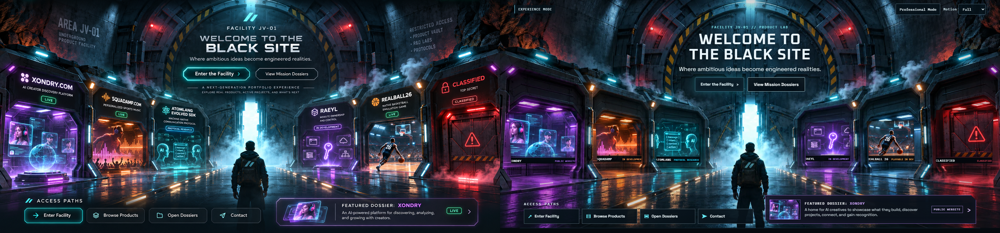

# JulianV.dev Black Site V3 visual QA

## Comparison method

The approved reference is 1672 x 941 and includes decorative browser chrome and page content that should not be copied as a static screenshot. The final page capture is also 1672 x 941. For the scene comparison, the reference is cropped at y=100 and the implementation at y=76; both crops are normalized to 1672 x 781. Header, footer, and reference browser chrome are excluded from this scene crop. Live navigation, labels, status copy, and buttons remain DOM content.

- [Before: prior 3D corridor](visual-qa/v3-before/home-1672x941.png)
- [After: image-driven home](visual-qa/v3-final/home-1672x941.png)
- [Before and after scene crops](visual-qa/v3-final/before-vs-after-scene.png)
- [50 percent reference overlay](visual-qa/v3-final/reference-final-overlay-50.png)
- [Difference image](visual-qa/v3-final/reference-final-difference.png)
- [All comparison dimensions and crops](visual-qa/v3-final/comparison-metadata.json)

No numerical similarity score is reported. The final environment is generated art and the implementation intentionally replaces reference copy with accurate project content.

## Iteration record

1. **Composition and mapping.** Replaced the procedural scene with the cleaned environment plate and mapped the six exhibit apertures, steam origins, and interaction hit areas through the shared 1672 x 941 cover transform. [Pass 1 capture](visual-qa/v3-pass1/initial-1672x941.png).
2. **Chamber art and mechanical layering.** Refined exhibit crop bounds, extracted matching shutter leaves, and tied unlock, vent, door slide, and reveal effects to the active bay. Project copy and statuses remain live HTML. [Pass 2 capture](visual-qa/v3-pass2/initial-1672x941.png), [Xondry open](visual-qa/v3-pass2/xondry-open-dossier.png).
3. **Typography, responsive behavior, and access.** Reduced the oversized title treatment, corrected small status labels, added tablet/mobile selectors and selected-exhibit access, and fixed pointer interception, reduced-motion access, focus behavior, and the mobile toolbar/hero overlap. [Pass 3 capture](visual-qa/v3-pass3/initial-1672x941.png), [mobile 390 px](visual-qa/v3-pass3/initial-390x844.png), [mobile 360 px](visual-qa/v3-pass3/initial-360x800.png).
4. **Final capture alignment.** The final desktop capture was initially 17 px taller than the 941 px reference because the stage and footer exceeded the viewport. The stage height was reduced, the page now captures at exactly 1672 x 941, and image decoding is awaited before capture. The latest mobile review also shifted the hero below the toolbar and shortened the RealBall chamber label to PLAYABLE IN DEV while retaining its full project status.
5. **Chamber depth and material pass.** Extracted alpha frame crops from the environment plate overlap the chamber inserts. Selected chambers reveal approved project artwork behind the moving shutters, and the open artwork uses a subtle brightness breath without pointer-driven zoom or glow. Reduced-motion behavior skips the plume animation. [Chamber before/after](visual-qa/visual-gap-final/chamber-before-after.png), [vapor placement before/after](visual-qa/visual-gap-final/vapor-placement-before-after.png).
6. **Embedded smoke loop.** The transparent plume art is rendered into a four-second alpha VP9 WebM. The lightweight video is preloaded on chamber selection, plays only while the selected chamber opens, then fades and unmounts before the revealed state settles. Reduced-motion visitors keep the still poster. [Vent before/after](visual-qa/smoke-loop-final/vapor-before-after.png), [smoke capture](visual-qa/smoke-loop-final/xondry-venting.png), [looping smoke video](../public/blacksite/art/steam-loop.webm).
7. **Header, buttons, footer, and plume alignment.** The home header now overlays the image scene and uses the cyan slash mark and online status treatment; primary and access actions use four-corner chamfers with a brighter cyan primary; the footer is a compact identity/contact strip with only verified destinations. The same slash mark remains visible in the sticky header on interior pages. The smoke loop was reduced and lowered toward the chamber vent. Tablet access actions use a two-column layout to avoid clipped labels. [Shell before/after](visual-qa/header-footer-final/before-after-home-1672x941.png), [desktop](visual-qa/header-footer-final/initial-1672x941.png), [tablet](visual-qa/header-footer-final/initial-1024x768.png), [mobile](visual-qa/header-footer-final/initial-390x844.png), [work index](visual-qa/header-footer-final/work-index-1440x900.png), [venting](visual-qa/header-footer-final/xondry-venting.png).
8. **Chamber blend and selection behavior.** All chambers begin sealed; selecting one opens only that bay, switching projects closes the prior bay, and the project details panel moves to the side opposite the selected chamber. Removed the persistent active hotspot outline and boxed artwork caption, then feathered each image to its aperture and blended it with the environment. [Before/after edge comparison](visual-qa/chamber-blend-final/edge-comparison.png), [closed chambers](visual-qa/chamber-blend-final/initial-1672x941.png), [open Xondry](visual-qa/chamber-blend-final/xondry-open-dossier.png), [dissipating smoke](visual-qa/chamber-blend-final/xondry-dissipating.png), [open RAEYL with panel opposite](visual-qa/chamber-blend-final/chamber-raeyl.png).
9. **Roof smoke and hover cleanup.** Replaced the plate's static roof wisps with an edited smoke-free plate, preserving the center floor fog. The selected bay now plays an animated plume from its roof vent only while the door opens, mirrors the plume on right-side bays, and lets it dissipate before the chamber settles. Removed pointer hover glow and image boosting while keeping keyboard focus visible. [Static-to-dynamic smoke comparison](visual-qa/smoke-cleanup-final/roof-smoke-before-after.png), [smoke motion across two frames](visual-qa/smoke-cleanup-final/smoke-motion-pair.png), [hovered open chamber](visual-qa/smoke-cleanup-final/xondry-open-hover.png).

For local alignment inspection, run the development server and add ?blacksiteDebug=1. The overlay shows the source-art origin, aperture boxes and polygons, vent anchors, and layer z-order; the flag is disabled in production.

[Development alignment overlay capture](visual-qa/v3-final/alignment-debug-dev.png)

Capture automation waits for page images to load and decode before saving screenshots. Its browser issue log contains no console errors, uncaught page errors, failed non-cancelled requests, or HTTP errors.

With the local preview running at port 3200, repeat the capture and comparison with npm run capture:blacksite and npm run compare:blacksite.

## Evidence set

| State | Capture |
| --- | --- |
| Home at 1672 x 941 | [Final](visual-qa/v3-final/home-1672x941.png) |
| Header/button/footer pass | [Before and after](visual-qa/header-footer-final/before-after-home-1672x941.png), [current desktop](visual-qa/header-footer-final/initial-1672x941.png) |
| Current responsive pass | [1024 x 768](visual-qa/header-footer-final/initial-1024x768.png), [390 x 844](visual-qa/header-footer-final/initial-390x844.png), [360 x 800](visual-qa/header-footer-final/initial-360x800.png) |
| Other desktop and tablet sizes | [1440 x 900](visual-qa/v3-final/initial-1440x900.png), [1920 x 1080](visual-qa/v3-final/initial-1920x1080.png), [1024 x 768](visual-qa/v3-final/initial-1024x768.png) |
| Mobile sizes | [390 x 844](visual-qa/v3-final/initial-390x844.png), [360 x 800](visual-qa/v3-final/initial-360x800.png), [selected Xondry](visual-qa/v3-final/chamber-open-390x844.png), [Xondry project page](visual-qa/v3-final/dossier-xondry-390x844.png) |
| Entry sequence | [Venting](visual-qa/v3-final/entry-venting.png), [door opening](visual-qa/v3-final/entry-opening.png), [entered](visual-qa/v3-final/entry-entered.png) |
| Chamber sequence | [Unlocking](visual-qa/v3-final/xondry-unlocking.png), [venting](visual-qa/v3-final/xondry-venting.png), [open project details](visual-qa/v3-final/xondry-open-dossier.png) |
| Current chamber interaction | [Doors closed at rest](visual-qa/smoke-cleanup-final/initial-1672x941.png), [no hover glow](visual-qa/smoke-cleanup-final/xondry-open-hover.png), [static-to-dynamic smoke](visual-qa/smoke-cleanup-final/roof-smoke-before-after.png), [two animated smoke frames](visual-qa/smoke-cleanup-final/smoke-motion-pair.png), [Xondry smoke dissipating](visual-qa/smoke-cleanup-final/xondry-dissipating.png), [settled open](visual-qa/smoke-cleanup-final/xondry-open-dossier.png), [RAEYL with opposite-side panel](visual-qa/smoke-cleanup-final/chamber-raeyl.png) |
| Other chamber exhibits | [SquadAMP](visual-qa/v3-final/chamber-squadamp.png), [AtomLang](visual-qa/v3-final/chamber-atomlang-evolved-sdk.png), [RAEYL](visual-qa/v3-final/chamber-raeyl.png), [RealBall26](visual-qa/v3-final/chamber-realball26.png), [Classified](visual-qa/v3-final/chamber-classified.png) |
| Keyboard and motion | [Keyboard focus](visual-qa/v3-final/keyboard-focus.png), [reduced motion](visual-qa/v3-final/reduced-motion-realball26.png) |
| Browser errors | [Empty latest issue log](visual-qa/smoke-cleanup-final/browser-issues.json) |

## Remaining visual differences

The final composition follows the reference's underground setting, arched blast door, central perspective, recessed chambers, wet walkway, and dramatic colored lighting. It remains a 2.5D image composition: chamber interiors use source-art image planes with aperture-shaped feathering; a full-scene foreground plate restores the lamps, nearby trim, wall edges, and chamber frames above them through irregular doorway cutouts; shutter doors are extracted 2D leaves; vapor is a looping WebM rendered from generated transparent plume art rather than volumetric simulation or live-action footage. The chamber edges now dissolve into the environment, although the project artwork itself still has the visual character of a projected image within a physical bay. The generated environment also differs in individual rock, steel, light, and floor details from the approved reference.

The chamber animation capture set is in [smoke-cleanup-final](visual-qa/smoke-cleanup-final/), with earlier layout and plume work in [header-footer-final](visual-qa/header-footer-final/). The preview also keeps the independent responsive mobile selector and selected artwork rather than attempting to shrink all six desktop apertures into a narrow viewport. The approved image's email address remains omitted because the content-truth document marks it illustrative; the footer links to the existing Contact route.
