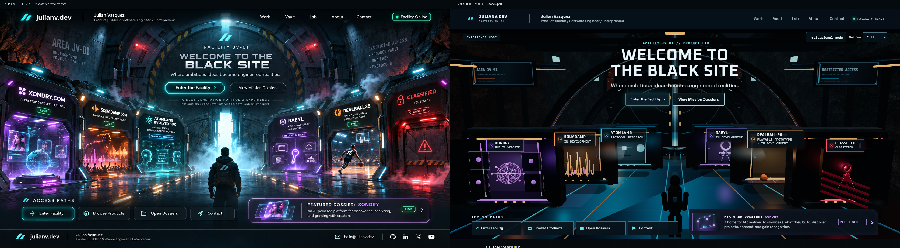

# Black Site V2 visual QA

## Comparison method

The approved image is 1672×941 and includes 49 pixels of decorative browser chrome. That chrome was cropped away before comparison. The final site screenshot is a direct 1672×941 CSS viewport capture from the production static export. The comparison image places both at 1672×892. The difference map and 50% overlay are included as inspection aids; because the reference is generated concept art, pixel similarity is not an acceptance score.

- [Difference map](visual-qa/final/difference.png)
- [50% overlay](visual-qa/final/overlay-50.png)
- [Before: original site at 1672×941](visual-qa/before/home-1672x941.png)
- [After: rebuilt site at 1672×941](visual-qa/final/home-1672x941.png)
- [Approved source image](visual-qa/reference/approved_black_site_1672x941.png)

## What changed after direct comparison

The initial implementation was a flat CSS scene with a ring motif and equal card row. The first live capture showed that additional CSS polish would not supply the missing depth, alcove scale, material variation, or mechanical motion. That led to an authored Three.js corridor, six depth-staged bays, physical pressure-door leaves, semantic DOM hotspots, and original material and product motifs.

The first source-level doorway correction did not appear in screenshots because the local static preview still served the previous `out/` export. I rebuilt the production export before recapturing. A subsequent comparison identified a solid backing disk that kept the moving leaves from revealing a passage; it was removed and replaced with an actual short inner corridor and lit bulkhead. The floor material was also made less reflective after the earlier pass produced an oversized sharp cyan patch. Entry screenshots were captured in full-motion `opening` and fully open Motion Off states to avoid timing-dependent captures.

| Review area | Before | Final | Evidence |
| --- | ---: | ---: | --- |
| Spatial hierarchy | 2/5 | 4/5 | Centered blast door, foreground Xondry/CLASSIFIED, receding inner bays, access rail, and dossier teaser are present. |
| Architecture and perspective | 1/5 | 4/5 | Connected stone shoulders, roof wings, service ribs/pipes, floor path, and a real passage behind the split leaves. |
| Materials, light, and atmosphere | 1/5 | 3/5 | Basalt albedo/bump, metal variation, local lights, restrained reflections, and low doorway plumes. The reference has richer photoreal surfaces and smoke. |
| Chamber recognition | 2/5 | 3/5 | Six unique spatial motifs, doors, lights, and project-accurate status labels; props remain illustrative. |
| Typography and legibility | 3/5 | 4/5 | Main copy is DOM text; the title and product statuses remain readable at target desktop and mobile sizes. |
| Responsive adaptation | 4/5 | 4/5 | Professional Mode is the small-screen default, with opt-in Experience Mode and no horizontal overflow at 320/390 px. |

Scores are qualitative judgments on a five-point scale, not visual-similarity metrics.

## Final screenshot set

| State | Capture |
| --- | --- |
| 1672×941 | [home-1672x941.png](visual-qa/final/home-1672x941.png) |
| 1440×900 | [home-1440x900.png](visual-qa/final/home-1440x900.png) |
| 1024×768 | [home-1024x768.png](visual-qa/final/home-1024x768.png) |
| 390×844 Professional / Experience | [Professional](visual-qa/final/home-390x844.png), [Experience](visual-qa/final/home-experience-390x844.png) |
| 320×720 Professional / Experience | [Professional](visual-qa/final/home-320x720.png), [Experience](visual-qa/final/home-experience-320x720.png) |
| Entry motion / fully open | [Opening](visual-qa/final/entry-entering.png), [open](visual-qa/final/entry-ready.png) |
| Product reveal / dossier | [Xondry](visual-qa/final/chamber-xondry-open.png), [AtomLang](visual-qa/final/chamber-atomlang-open.png), [Classified](visual-qa/final/chamber-classified-open.png), [Xondry dossier](visual-qa/final/dossier-xondry.png) |
| No-JavaScript server-rendered product index | [no-js-professional.png](visual-qa/final/no-js-professional.png) |

## Remaining visual differences

The approved image has denser industrial detail, brighter cinematic falloff, broader white steam, and actual human/product visuals. The site uses intentionally original, optimized geometry and a generated basalt map rather than a static screenshot or unavailable licensed models. The resulting world and interactions are real, but the individual product props are still graphic and less photoreal than the concept. The reference also includes incorrect `LIVE` labels for some products; the site keeps verified project statuses instead.
